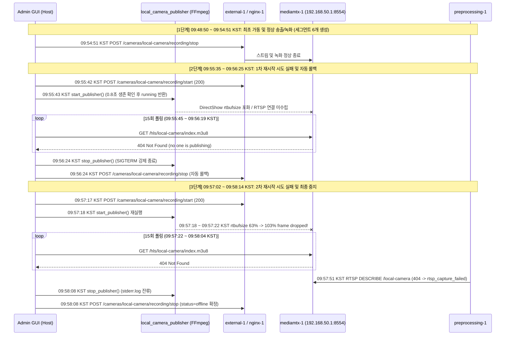

# 서버 로컬 카메라(`local-camera`) 미작동 원인 분석 보고서

- 작성 시각: 2026-11-15 (KST, UTC+9)
- 대상 시스템: Windows 서버 호스트(`C:\ProgramData\AI_CCTV`) 및 Docker 컨테이너 스택 (`mediamtx-1`, `external-1`, `preprocessing-1`, `data-1`, `nginx-1`)
- 관련 코드 및 문서:
  - [__main__.py](file:///C:/Users/gksrn/Desktop/new_structure/server/local_camera_publisher/__main__.py)
  - [local_camera.py](file:///C:/Users/gksrn/Desktop/new_structure/server/operations/local_camera.py)
  - [application.py](file:///C:/Users/gksrn/Desktop/new_structure/server/desktop/admin/application.py)
  - [launcher.py](file:///C:/Users/gksrn/Desktop/new_structure/server/desktop/launcher.py)
  - [compose.yml](file:///C:/Users/gksrn/Desktop/new_structure/server/compose.yml)
  - [pi-camera-stream-fix-plan.md](file:///C:/Users/gksrn/Desktop/new_structure/docs/pi-camera-stream-fix-plan.md)
  - [pi-camera-stream-remediation-plan.md](file:///C:/Users/gksrn/Desktop/new_structure/docs/pi-camera-stream-remediation-plan.md)

---

## 1. 진단 요약

현재 서버의 로컬 카메라(`local-camera`, 장치명 `720p HD Camera`)는 **호스트 송출 프로세스(FFmpeg)가 완전히 종료되어 있고, 데이터베이스 상でも `status='offline'`, `recording_enabled=0`, `stream_requested=0`으로 비활성화된 상태**입니다.

로그와 런타임 파일, 소스코드를 교차 분석한 결과 장애 발생 경위와 직접 원인은 다음과 같습니다.

1. **`09:48:55` ~ `09:54:51 KST` 구간에는 정상 송출 및 녹화가 이루어졌으나, 사용자가 `09:54:51 KST`에 전체 녹화를 중지한 뒤 `09:55:35 KST` 및 `09:57:02 KST`에 Admin 앱에서 재시작을 시도할 때 모두 실패했습니다.**
2. **직접 원인 (FFmpeg 캡처 버퍼 포화 및 RTSP 연결 미수립)**:
   - 재시작 시 호스트의 DirectShow 캡처 장치(`720p HD Camera`)에서 프레임을 읽는 동안 FFmpeg의 인코더 초기화/RTSP 출력 연결 단계가 블로킹되면서, 기본 3MB(`3041280` bytes)에 불과한 DirectShow 실시간 버퍼(`rtbufsize`)가 약 4초 만에 **63% → 103%로 포화되어 프레임 드롭(`frame dropped!`)이 연속 발생**했고 MediaMTX(`8554`)로 RTSP 게시 연결이 전혀 수립되지 못했습니다.
3. **구조적 원인 1 (가짜 기동 성공 판정 및 폴백 미작동)**:
   - [__main__.py](file:///C:/Users/gksrn/Desktop/new_structure/server/local_camera_publisher/__main__.py#L221-L253)는 첫 번째 코덱 후보(`h264_nvenc`)로 FFmpeg 실행 후 **단 `0.8초` 동안 프로세스가 종료되지 않고 살아있기만 하면(`child.poll() is None`) 실제 RTSP 연결 여부와 무관하게 기동 성공(`running`)으로 판정**합니다.
   - 또한 FFmpeg 프로세스가 즉시 종료(`rc != 0`)되지 않고 출력 연결이나 인코더 초기화에서 지연/행(hang) 상태에 빠지면 두 번째 후보(`libx264`)로의 폴백이 작동하지 않습니다.
4. **구조적 원인 2 (Admin GUI의 HLS 폴링 타임아웃 후 자동 롤백)**:
   - [application.py](file:///C:/Users/gksrn/Desktop/new_structure/server/desktop/admin/application.py#L1065-L1134)의 `_start_local_camera_for_recording()`은 송출기 기동 직후 `_wait_for_local_camera()`를 통해 `/hls/local-camera/index.m3u8`을 15회 폴링합니다.
   - 15회 모두 `404 Not Found`를 반환받자 예외 처리(롤백) 블록이 실행되어 **호스트 송출기를 강제 종료(`self.local_publisher.stop()`)하고 서버에 녹화 중지(`POST /api/v1/cameras/local-camera/recording/stop`)를 자동 요청**하여 현재의 `offline` 상태로 되돌렸습니다.
5. **복합 요인 (다중 카메라 구동 시 백엔드 타임아웃 및 RTSP 바인딩 변경 영향)**:
   - `cam-001`(라즈베리파이 카메라)과 동시 구동 시 `preprocessing-1`의 모델 준비 30초 타임아웃(`DETECTION_MODEL_TIMEOUT`)과 `external-1` ↔ `data-1` 간 5초 조회 타임아웃(`DataServiceUnavailable`, `503`)이 중첩 발생했습니다.
   - 또한 [compose.yml](file:///C:/Users/gksrn/Desktop/new_structure/server/compose.yml#L170-L173)에서 MediaMTX의 `8554` 포트가 `RTSP_BIND_ADDRESS`(`192.168.50.1`)에만 바인딩되어 있어, 실행 경로가 기본값(`127.0.0.1`)이나 이전 대역(`192.168.1.10`)을 바라볼 경우 로컬 송출기가 MediaMTX에 접속할 수 없는 구조적 취약점이 존재합니다.

---

## 2. 현재 관측 상태

### 2.1 데이터베이스 상태 (`C:\ProgramData\AI_CCTV\database\ai_cctv.db`)

| 구분 | `cam-001` (`raspi01`) | `local-camera` (`720p HD Camera`) |
| --- | --- | --- |
| `cameras.enabled` | `1` | `1` |
| `cameras.status` | `online` | **`offline`** |
| `cameras.recording_enabled` | `1` | **`0`** |
| `cameras.stream_requested` | `1` | **`0`** |
| `cameras.updated_at` (UTC) | `2026-11-15T00:55:35.580Z` | **`2026-11-15T00:58:08.621Z`** |
| `camera_runtime_status.stream_state` | `streaming` | **`stopped`** |
| `camera_runtime_status.last_error_code` | `None` | `None` |

### 2.2 호스트 런타임 및 설정 파일 (`C:\ProgramData\AI_CCTV\`)

- `config\local-camera.json`:
  ```json
  {
    "enabled": true,
    "device_name": "720p HD Camera"
  }
  ```
- `config\compose.env` 및 `config\config.yaml`:
  - `PUBLIC_BIND_ADDRESS=192.168.1.10`
  - `RTSP_BIND_ADDRESS=192.168.50.1`, `RTSP_PUBLIC_HOST=192.168.50.1`, `RTSP_PORT=8554`
  - `PREPROCESSING_GPU=false`
- `runtime\` 디렉터리 상태:
  - `local-camera.json` (실행 중 상태 파일): **없음**
  - `local-camera.error.txt` (오류 기록 파일): **없음**
  - 호스트 내 실행 중인 `local_camera_publisher` / `ffmpeg` 프로세스: **없음 (`stopped`)**
  - `local-camera.stderr.log`: **존재함** (생성: `09:55:43.399 KST`, 최종 수정: `09:57:22.346 KST`, 크기: 1,317 bytes)
    ```text
    [dshow @ 0000010e54c60ec0] real-time buffer [720p HD Camera] [video input] too full or near too full (63% of size: 3041280 [rtbufsize parameter])! frame dropped!
    [dshow @ 0000010e54c60ec0] real-time buffer [720p HD Camera] [video input] too full or near too full (75% of size: 3041280 [rtbufsize parameter])! frame dropped!
    ...
    [dshow @ 0000010e54c60ec0] real-time buffer [720p HD Camera] [video input] too full or near too full (103% of size: 3041280 [rtbufsize parameter])! frame dropped!
    ```

---

## 3. 시간대별 상세 로그 타임라인 (2026-11-15)

> [!NOTE]
> 컨테이너 내부 로그는 UTC(`Z`) 기준이며, 아래 표에서는 한국 표준시(**KST = UTC+9**)와 함께 병기합니다.



### 3.1 1단계: 최초 가동 및 정상 송출 구간 (`09:48:50` ~ `09:54:51 KST`)

- **`09:48:53` ~ `09:48:58 KST` (`00:48:53Z` ~ `00:48:58Z`)**:
  - `POST /api/v1/cameras/local-camera/publish-credentials/rotate` (`200`) 및 `POST /api/v1/cameras/local-camera/recording/start` (`200`) 호출 직후, 호스트 FFmpeg가 `192.168.50.1:53593 -> 192.168.50.1:8554`로 MediaMTX에 접속하여 정상 게시를 시작했습니다.
  - `mediamtx-1` 로그:
    ```text
    2026/11/15 00:48:58 INF [RTSP] [session 036fdab8] is publishing to path 'local-camera', 1 track (H264)
    ```
- **`09:48:58` ~ `09:54:51 KST` (`00:48:58Z` ~ `00:54:51Z`)**:
  - 약 6분 동안 `local-camera`의 중앙 녹화 MP4 세그먼트 6개(`recording_segments` ID `184, 185, 186, 188, 190, 193`)와 객체 감지 이벤트(`person_appeared` ID `259, 262, 266, 270, 273`)가 정상 생성되었습니다.
  - 단, `09:51:05 KST`(`00:51:05Z`)에 `cam-001` 녹화가 추가 시작된 시점부터 백엔드 과부하 징후가 나타났습니다:
    - `preprocessing-1`: `cam-001` 추론 워커에서 30초 모델 준비 타임아웃(`DETECTION_MODEL_TIMEOUT`, `00:51:45Z`, `00:52:45Z`, `00:53:45Z`, `00:54:45Z`) 및 `local-camera` 실시간 객체 전달 타임아웃(`error_code=TIMEOUT elapsed_seconds=2.004`) 반복 발생.
    - `external-1`: `data` 서비스 조회 시 5초 타임아웃(`DataServiceUnavailable`, `MEDIA_AUTH_CAMERA_LOOKUP_FAILED data_ms=5010.3`)이 발생하여 `00:52:05Z` 및 `00:52:13Z`의 `GET /api/v1/cameras/local-camera/live` 요청이 `503 Service Unavailable`을 반환.
- **`09:54:50` ~ `09:54:54 KST` (`00:54:50Z` ~ `00:54:54Z`)**:
  - 사용자가 녹화 중지를 실행하여 `cam-001`과 `local-camera` 모두 정상적으로 중지(`POST .../recording/stop`)되었고 MediaMTX 세션(`036fdab8`)이 닫혔습니다.

### 3.2 2단계: 1차 재시작 시도 실패 및 자동 롤백 (`09:55:28` ~ `09:56:25 KST`)

- **`09:55:35` ~ `09:55:42 KST` (`00:55:35Z` ~ `00:55:42Z`)**:
  - Admin GUI에서 전체 녹화 시작이 호출되어 `cam-001`이 먼저 재시작(`00:55:37Z`부터 정상 스트리밍)된 후, `local-camera`에 대해 등록 확인(`POST /api/v1/cameras` `409` → `PATCH /api/v1/cameras/local-camera` `200`), 자격증명 회전(`rotate` `200`), 녹화 시작(`POST /api/v1/cameras/local-camera/recording/start` `200`)이 순차 실행되었습니다.
- **`09:55:43.399 KST` (`00:55:43.399Z`)**:
  - 호스트에서 `local_camera_publisher`가 시작되며 `runtime\local-camera.stderr.log` 파일이 생성되었습니다.
  - 그러나 이 시점 이후 **`mediamtx-1`에는 `local-camera` 경로에 대한 RTSP 게시 연결이 단 한 건도 들어오지 않았습니다.**
- **`09:55:45` ~ `09:56:19 KST` (`00:55:45Z` ~ `00:56:19Z`)**:
  - Admin GUI의 `_wait_for_local_camera()`가 `GET /hls/local-camera/index.m3u8`을 15회 요청했으나, 게시자가 없으므로 MediaMTX는 매번 `destroyed: no one is publishing to path 'local-camera'`와 함께 `404 Not Found`를 반환했습니다.
- **`09:56:24.871 KST` (`00:56:24.871Z`)**:
  - 15회 폴링이 모두 실패하자 Admin GUI의 예외 롤백 코드가 동작하여 송출기를 종료하고 `POST /api/v1/cameras/local-camera/recording/stop`을 호출했습니다.

### 3.3 3단계: 2차 재시작 시도 실패 및 최종 중지 (`09:57:02` ~ `09:58:14 KST`)

- **`09:57:02` ~ `09:57:17 KST` (`00:57:02Z` ~ `00:57:17Z`)**:
  - Admin GUI에서 다시 `local-camera` 시작을 시도하여 자격증명 회전(`00:57:15Z`) 및 `recording/start`(`00:57:17Z`)가 성공(`200`)했습니다.
- **`09:57:18` ~ `09:57:22.346 KST` (`00:57:18Z` ~ `00:57:22.346Z`)**:
  - FFmpeg가 다시 기동되었으나 `local-camera.stderr.log`에 DirectShow 실시간 버퍼 포화 및 프레임 드롭 에러(`63%` → `103% of size: 3041280 [rtbufsize parameter]! frame dropped!`)만 기록하고 MediaMTX에 RTSP 연결을 맺지 못했습니다.
- **`09:57:22` ~ `09:58:04 KST` (`00:57:22Z` ~ `00:58:04Z`)**:
  - Admin GUI의 HLS 플레이리스트 폴링 15회가 다시 모두 `404`로 실패했습니다.
  - `09:57:51 KST`(`00:57:51Z`)에는 `preprocessing-1`도 `rtsp://mediamtx:8554/local-camera` 캡처를 시도하다가 `404 Not Found`를 받고 `inference_stream_lost (rtsp_capture_failed)` 이벤트를 기록했습니다.
- **`09:58:08.621 KST` (`00:58:08.621Z`)**:
  - Admin GUI 롤백 로직이 다시 실행되어 `stop_publisher()`로 헬퍼 프로세스를 강제 종료하고 `POST /api/v1/cameras/local-camera/recording/stop`을 호출하면서 현재의 `offline` 상태로 최종 고정되었습니다.

---

## 4. 근본 원인 상세 분석

### 원인 1: FFmpeg DirectShow 캡처 버퍼(`rtbufsize`) 부족 및 출력 초기화 블로킹 시 코덱 폴백 불능

- **코드 위치**: [__main__.py](file:///C:/Users/gksrn/Desktop/new_structure/server/local_camera_publisher/__main__.py#L31-L82), [__main__.py](file:///C:/Users/gksrn/Desktop/new_structure/server/local_camera_publisher/__main__.py#L221-L253)
- **상세 메커니즘**:
  1. `_build_command()`는 Windows DirectShow 입력(`-f dshow -i video=720p HD Camera`)을 구성할 때 `-rtbufsize` 옵션을 지정하지 않습니다. FFmpeg의 DirectShow 기본 버퍼 크기는 `3,041,280 bytes`(약 3MB)로, 비압축 720p 프레임 기준 1~2장만 쌓여도 즉시 포화됩니다.
  2. `_codec_candidates()`는 기본적으로 `("h264_nvenc", "libx264")` 순서로 시도합니다(`PREPROCESSING_GPU=false`로 설정되어 있을 만큼 호스트 GPU/NVENC 여건이 불안정하거나 없는 환경에서도 항상 `h264_nvenc`를 먼저 시도).
  3. FFmpeg가 DirectShow 장치를 여는 순간 캡처 스레드는 버퍼에 프레임을 채우기 시작하지만, 뒤이어 수행되는 인코더 초기화(`h264_nvenc`)나 RTSP TCP 연결/핸드셰이크(`-f rtsp -rtsp_transport tcp ...`)에서 수 초만 지연되어도 3MB 버퍼가 103%까지 차오르며 프레임을 연속 드롭합니다.
  4. 특히 [__main__.py](file:///C:/Users/gksrn/Desktop/new_structure/server/local_camera_publisher/__main__.py#L221-L253)의 폴백 루프는 **자식 FFmpeg 프로세스가 `0.8초`(`_startup_wait_seconds("h264_nvenc")`) 또는 `5.0초`(`EARLY_FAILURE_FALLBACK_SECONDS`) 이내에 스스로 비정상 종료(`rc != 0`)해야만** `libx264`로 폴백합니다. FFmpeg가 종료되지 않고 연결/초기화 대기 상태로 살아있으면 `0.8초` 시점에 즉시 `"running"` 상태를 기록하고 `child.wait()`로 무한 대기하므로 `libx264` 폴백이 전혀 실행되지 않습니다.

### 원인 2: `0.8초` 프로세스 생존 기반의 가짜 기동 판정과 Admin GUI의 자동 롤백

- **코드 위치**: [local_camera.py](file:///C:/Users/gksrn/Desktop/new_structure/server/operations/local_camera.py#L211-L276), [application.py](file:///C:/Users/gksrn/Desktop/new_structure/server/desktop/admin/application.py#L1065-L1134), [application.py](file:///C:/Users/gksrn/Desktop/new_structure/server/desktop/admin/application.py#L1218-L1254)
- **상세 메커니즘**:
  1. `start_publisher()`는 헬퍼 프로세스가 `runtime\local-camera.json`에 `"status": "running"`을 기록하기만 하면 성공으로 간주하고 반환합니다. 즉 MediaMTX에 실제로 RTSP `ANNOUNCE`/`RECORD`가 수립되었는지 검증하지 않습니다.
  2. 직후 Admin GUI의 `_start_local_camera_for_recording()`은 `_wait_for_local_camera()`를 호출하여 약 15~38초 동안 `/hls/local-camera/index.m3u8`을 15회 폴링합니다.
  3. 이 기간 내에 HLS 플레이리스트가 생성되지 않으면 `RuntimeError("15초 안에 노트북 카메라 영상이 서버에 도착하지 않았습니다.")`를 발생시키고, [application.py](file:///C:/Users/gksrn/Desktop/new_structure/server/desktop/admin/application.py#L1123-L1134)의 `except Exception:` 블록에서 아래 롤백을 수행합니다:
     - `self.local_publisher.stop()`: Windows에서 `os.kill(pid, signal.SIGTERM)`(`TerminateProcess`)로 헬퍼 프로세스를 즉시 강제 종료합니다. 이로 인해 헬퍼의 `finally:` 블록(`stderr_log.unlink()`)이 실행되지 못해 `local-camera.stderr.log`만 남고 `local-camera.json`은 삭제됩니다.
     - `self.client.stop_camera_recording(LOCAL_CAMERA_ID)`: 서버에 녹화 중지를 요청하여 DB의 `recording_enabled=0`, `stream_requested=0`, `status='offline'`을 확정합니다.

### 원인 3: RTSP 바인딩 주소(`192.168.50.1`) 분리 및 실행 경로 간 설정 불일치 위험

- **코드 위치**: [compose.yml](file:///C:/Users/gksrn/Desktop/new_structure/server/compose.yml#L170-L173), [launcher.py](file:///C:/Users/gksrn/Desktop/new_structure/server/desktop/launcher.py#L46-L78), [application.py](file:///C:/Users/gksrn/Desktop/new_structure/server/desktop/admin/application.py#L223-L253)
- **상세 메커니즘**:
  - `08:42 KST`에 Pi 카메라 수신을 위해 `compose.env`의 `RTSP_BIND_ADDRESS`와 `RTSP_PUBLIC_HOST`를 `192.168.50.1`로 변경하면서, `mediamtx` 컨테이너의 `8554` 포트는 호스트의 `192.168.50.1:8554`에만 바인딩되어 있습니다(`127.0.0.1:8554`나 `192.168.1.10:8554`로는 접속 불가).
  - [launcher.py](file:///C:/Users/gksrn/Desktop/new_structure/server/desktop/launcher.py#L51-L65)를 거치지 않고 [application.py](file:///C:/Users/gksrn/Desktop/new_structure/server/desktop/admin/application.py#L228)가 기본 인자로 실행되거나 이전 주소(`192.168.1.10`)를 유지한 세션에서 실행될 경우, `LocalCameraPublisherController`는 `--rtsp-host 127.0.0.1` 또는 `192.168.1.10`으로 접속을 시도하게 되어 MediaMTX 연결이 실패하고 DirectShow 버퍼만 포화됩니다.

### 원인 4: 다중 카메라 동시 구동 시 `preprocessing` / `data` / `external` 서비스 간 병목

- `cam-001`과 `local-camera`가 동시에 활성화될 때 CPU 기반 추론(`PREPROCESSING_GPU=false`) 및 SQLite/API 부하로 인해:
  - `preprocessing-1`에서 모델 준비 30초 타임아웃(`DETECTION_MODEL_TIMEOUT`)과 스트림 수신 타임아웃(`Stream timeout triggered after 5038 ms`)이 발생하고,
  - `external-1`에서 `data-1` 조회 시 5초 타임아웃(`DataServiceUnavailable`, `MEDIA_AUTH_CAMERA_LOOKUP_FAILED data_ms=5010.3`)이 발생하여 MediaMTX의 `media-auth` 웹훅 응답 및 라이브 스트림 준비 시간을 지연시켰습니다.

---

## 5. 복구 및 개선 권고 사항

1. **FFmpeg DirectShow 캡처 버퍼 확대 및 저지연 옵션 보강 ([__main__.py](file:///C:/Users/gksrn/Desktop/new_structure/server/local_camera_publisher/__main__.py))**
   - DirectShow 입력 인자에 `-rtbufsize 256M`(또는 최소 `100M`) 및 입력 프레임레이트/해상도 명시 옵션을 추가하여, 초기 인코더/네트워크 연결 대기 중 프레임 드롭과 버퍼 오버플로가 발생하지 않도록 해야 합니다.
   - RTSP 출력에도 `-stimeout`(또는 `-timeout`) 옵션을 부여해 연결 지연 시 무한 블로킹되지 않고 즉시 종료되어 다음 코덱 후보로 폴백되도록 개선해야 합니다.
2. **코덱 선택 정책 개선 ([__main__.py](file:///C:/Users/gksrn/Desktop/new_structure/server/local_camera_publisher/__main__.py))**
   - `PREPROCESSING_GPU=false`이거나 NVENC가 불안정한 호스트에서는 `AI_CCTV_LOCAL_CAMERA_CODEC=libx264`를 기본 적용하거나, `libx264`를 1순위로 시도하도록 변경하여 불필요한 `h264_nvenc` 초기화 지연을 제거하는 것이 안전합니다.
3. **RTSP 바인딩 및 로컬 루프백 접속 보장 ([compose.yml](file:///C:/Users/gksrn/Desktop/new_structure/server/compose.yml), [application.py](file:///C:/Users/gksrn/Desktop/new_structure/server/desktop/admin/application.py))**
   - 호스트 내부 프로세스(`local_camera_publisher`)가 어댑터 IP 변경에 영향받지 않도록 `compose.yml`에서 `127.0.0.1:8554:8554` 바인딩을 추가(또는 `0.0.0.0:8554` 바인딩)하거나, `application.py`가 기동 시 항상 `C:\ProgramData\AI_CCTV\config\compose.env`의 `RTSP_PUBLIC_HOST`를 직접 읽도록 통일해야 합니다.
4. **기동 판정 및 HLS 준비 대기 시간 개선 ([local_camera.py](file:///C:/Users/gksrn/Desktop/new_structure/server/operations/local_camera.py), [application.py](file:///C:/Users/gksrn/Desktop/new_structure/server/desktop/admin/application.py))**
   - 단순 `0.8초` 프로세스 생존 여부가 아니라 실제 RTSP 세션 연결(또는 stderr의 `Output #0, rtsp` 출력)을 확인한 뒤 `"running"`으로 전환하고, 롤백 전 `local-camera.stderr.log`의 마지막 오류를 `local-camera.error.txt`에 보존하도록 종료 처리를 개선해야 합니다.
